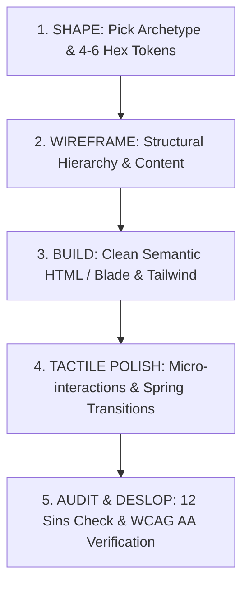

# Super UI Total: Master-Grade UI & Design Engineering

A comprehensive, production-grade design engineering skill synthesized directly from the world's premier agent design frameworks:
- **`ui-skills.com` / `ibelick/ui-skills`** (`baseline-ui`, `improve-ui`, `fixing-accessibility`, `fixing-motion-performance`, `create-design-md`).
- **`nextlevelbuilder/ui-ux-pro-max-skill`** (10-Priority Decision Hierarchy, Anti-Pattern Catalog, Pro-Rules & Quality Gates).
- **`agenticskills.io/category/design`**:
  - **Anthropic Frontend Design**: The Anti-Slop Manifesto, intentional aesthetic archetypes, context-driven 4–6 token palettes, structural wireframing.
  - **Paul Bakaus's Impeccable**: Deterministic anti-pattern heuristics, vocabulary commands (`shape`, `critique`, `audit`, `polish`, `bolder`, `quieter`, `distill`, `harden`, `typeset`).
  - **Emil Kowalski's Design Engineering**: Physics-informed spring motion, tactile press states (`active:scale-[0.98]`), origin-aware popovers, layered micro-borders over fuzzy shadows.

---

## Core Philosophy: Eliminate AI-Slop, Elevate Visual Craft

Standard AI assistants fall into **distributional convergence**: creating bland, average interfaces with default Inter typography, centered purple/indigo gradients, floating blurry cards, low-contrast gray text, and lifeless interactions.

**Super UI Total enforces a strict quality floor:**
1. **Never default to average:** Commit 100% to a chosen aesthetic archetype (e.g., Linear Precision, Swiss Editorial, Warm Crafted, Fintech Utilitarian).
2. **Tactile & alive:** Every interactive surface must respond instantly to touch/click with physics-informed feedback.
3. **Structured depth:** Layered 1px semi-transparent borders and subtle elevations replace heavy, fuzzy drop shadows.
4. **Ergonomic & accessible:** Zero compromises on WCAG AA compliance, 44px mobile tap targets, and visible focus rings.
5. **Modern performance:** Durations $\le 200\text{ms}$, compositor-only transitions (`transform`, `opacity`), and full Tailwind CSS v4 / Blade optimization.

---

## Command Suite & Sub-Workflows

Use these steering commands to trigger specialized design phases:

| Command | Purpose | Action Taken |
| :--- | :--- | :--- |
| `/shape` | **Pre-design blueprint** | Select archetype, define 4–6 token palette, draft ASCII wireframe, run anti-default critique before writing code. |
| `/layout` | **Layout & spatial systems** | Structure 8pt grid rhythms, app shells, asymmetric Bento grids, split heroes, and container boundaries. |
| `/baseline` | **Enforce baseline constraints** | Audit file against layout, viewport (`h-dvh`), typography (`text-balance`), and primitive rules. |
| `/polish` | **Micro-interaction pass** | Add Emil Kowalski tactile states (`active:scale-[0.98]`), crisp layered borders, and snappy springs. |
| `/audit` | **Slop & a11y scanner** | Deterministic check against the 12 Slop Sins, color contrast ($\ge 4.5:1$), and tap targets ($\ge 44\text{px}$). |
| `/critique` | **Design evaluation** | Analyze visual tension, whitespace balance, optical weight, and information hierarchy. |
| `/bolder` | **Amplify character** | Increase contrast, sharpen typography, strengthen accent moments for timid or flat designs. |
| `/quieter` | **Distill minimalism** | Remove superfluous borders, soften visual noise, relax tight padding, distill to essentials. |

---

## 5-Step Execution Workflow

Follow this mandatory 5-step workflow on any non-trivial UI task:

### Step 1: Shape (Aesthetic Point of View)
Before writing a single utility class, select a defined aesthetic direction:
- **Linear / Raycast Dark Precision**: Monochromatic zinc/slate, crisp `border-white/10`, monospace accents, snappy 150ms transitions.
- **Editorial / Swiss Modern**: Strong serif/display headers, asymmetric grids, generous whitespace, minimal border lines.
- **Warm Humanist / Crafted**: Warm stone/neutral tones, tactile pill badges, soft layered warmth, rounded geometric sans.
- **Fintech / Data Utilitarian**: High-density layouts, `tabular-nums`, tinted status chips, zero wasted vertical space.
- **Neo-Brutalist / Industrial**: 2px solid dark borders, hard drop shadows (`shadow-[3px_3px_0_0_#000]`), bold accent punch.

### Step 2: Establish the 4–6 Token Palette
Never scatter arbitrary colors. Define exact semantic roles:
- `--bg`: Canvas background
- `--surface`: Elevated container / card
- `--border`: Crisp structural separation (`border-neutral-200/80 dark:border-neutral-800/80`)
- `--primary`: Main call-to-action
- `--text-main` / `--text-muted`: Strict contrast ($\ge 4.5:1$)
- `--danger`: Destructive actions

### Step 3: Build Semantic Structure
- Use accessible primitives (`<dialog>`, native form elements, Blade components).
- Modern viewports: `h-dvh` instead of `h-screen`.
- Typography utilities: `text-balance` on headings, `text-pretty` on body copy, `tabular-nums` on numbers/currency.

### Step 4: Emil Kowalski Micro-Interactions & Polish
- Add tactile press states: `active:scale-[0.98] transition-transform duration-100 ease-out`.
- Layered borders over blurry shadows: `border border-neutral-200/80 shadow-xs dark:border-white/10`.
- Fast, origin-aware transitions: Popovers animate from `origin-top scale-95 opacity-0` $\to$ `scale-100 opacity-100` within 150ms.
- Respect reduced motion: `motion-reduce:transition-none`.

### Step 5: Audit & Deslop
Run the deterministic slop checklist:
- [ ] No generic purple/indigo gradient backgrounds?
- [ ] No fake/pretentious hero pill badges (e.g. `Direktori Aktif • Khusus...`, `Platform #1`)? Let H1 lead directly.
- [ ] Strictly zero emojis used as UI icons, badge ornaments, or list bullets (no ⏱️, 💰, ⚡, 📍, ⏳)?
- [ ] Strict icon restraint: zero unnecessary decorative icons (icons only when functionally required for search, close, chevron)?
- [ ] No gray text failing 4.5:1 contrast on white or dark surfaces?
- [ ] No cards inside cards with identical borders and paddings?
- [ ] All icon-only buttons have an explicit `aria-label`?
- [ ] All interactive tap targets on mobile are at least $44 \times 44\text{px}$?
- [ ] Viewport uses `h-dvh` and accounts for `safe-area-inset`?

---

## Specialized Rule Index

Deep-dive into specific sub-rules when designing or refactoring:

| Topic | Rule Document | What It Covers |
| :--- | :--- | :--- |
| **Anti-Slop Manifesto** | [`rules/01-anti-slop-manifesto.md`](rules/01-anti-slop-manifesto.md) | The 12 Cardinal AI-Slop Sins and deterministic audit checks. |
| **Visual Craft & Tokens** | [`rules/02-visual-craft-and-tokens.md`](rules/02-visual-craft-and-tokens.md) | 5 archetypes, layered border formulas, lighting, typography hierarchy. |
| **Micro-Interactions & Motion** | [`rules/03-micro-interactions-and-motion.md`](rules/03-micro-interactions-and-motion.md) | Emil Kowalski physics, spring curves, durations $\le 200\text{ms}$, origins. |
| **Accessibility & Ergonomics** | [`rules/04-accessibility-and-ergonomics.md`](rules/04-accessibility-and-ergonomics.md) | WCAG AA, 44px tap targets, focus rings, keyboard flows, screen readers. |
| **Tailwind v4 & Blade Patterns** | [`rules/05-modern-tailwind-v4-blade.md`](rules/05-modern-tailwind-v4-blade.md) | Tailwind v4 `@theme`, modern CSS, reusable Blade component architecture. |
| **Layout & Spatial Systems** | [`rules/06-layout-composition-and-spatial-systems.md`](rules/06-layout-composition-and-spatial-systems.md) | 8pt spatial grid, SaaS app shells, Bento grids, split heroes, alignment rules. |
| **UI/UX Pro Max 10 Priorities** | [`rules/07-ui-ux-pro-max-priority-framework.md`](rules/07-ui-ux-pro-max-priority-framework.md) | 10-priority execution sequence, dual-input search, pro-rules, anti-patterns. |
| **Project Design Template** | [`templates/DESIGN.md`](templates/DESIGN.md) | Starter file to document project design tokens, voice, and rules. |

---

## Laravel 13 & Tailwind CSS v4 Quick Reference

In this project, always leverage:
1. **Tailwind v4 CSS-first config:** Token definitions live in `resources/css/app.css` under `@theme`.
2. **Blade Component reuse:** Extract repeated UI patterns into `<x-button>`, `<x-card>`, `<x-badge>`, `<x-input>`, and `<x-modal>`.
3. **Pint formatting:** Format PHP/Blade files using `vendor/bin/pint --format agent` after modifying PHP templates.
